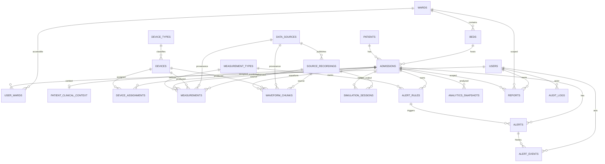

# BioPulse MySQL persistence

MySQL 8.4, InnoDB, Java 21, JDBC, HikariCP and Flyway are the persistence stack. Database name: `biomedical_dashboard`. V1–V6 live in `database/migrations`; Maven packages them into the standard `db/migration` classpath location. V1 was moved without changing its SQL, so its Flyway checksum remains compatible with existing installations. Flyway applies each version once and checks its checksum on later starts. Back up data before any upgrade. Never edit an applied migration.

## Setup

Create a MySQL 8.x database and restricted application account:

```sql
CREATE DATABASE biomedical_dashboard CHARACTER SET utf8mb4 COLLATE utf8mb4_0900_ai_ci;
CREATE USER 'biopulse'@'%' IDENTIFIED BY '<choose-a-secret>';
GRANT SELECT, INSERT, UPDATE, DELETE, CREATE, ALTER, INDEX, REFERENCES, TRIGGER
  ON biomedical_dashboard.* TO 'biopulse'@'%';
```

Set `DB_URL=jdbc:mysql://localhost:3306/biomedical_dashboard?connectionTimeZone=UTC&forceConnectionTimeZoneToSession=true`, `DB_USER`, and `DB_PASSWORD`. Spring Boot configures HikariCP with a 12 connection maximum and 10 second acquisition timeout. Flyway runs at startup. The first migration is the existing live V1 schema; V2–V6 extend it without dropping data. For a new database, point Docker Compose's `MYSQL_DATABASE` and app `DB_URL` to `biomedical_dashboard`, or set the same variables in another deployment.

Run `./mvnw verify` with Docker running for JUnit 5/Testcontainers MySQL integration tests. The optional `database/seeds/synthetic_demo.sql` adds ten clearly labeled fictional patients, two disabled users, two wards, ten beds, and five devices. Apply it only in development: `mysql -u biopulse -p biomedical_dashboard < database/seeds/synthetic_demo.sql`. The application has a separate opt-in runtime fixture controlled by `SEED_DEMO` and `DEMO_PASSWORD`.

## Backup and restore

Stop writes or take a consistent InnoDB snapshot. Example:

```sh
mysqldump --single-transaction --routines --triggers --set-gtid-purged=OFF -u backup -p biomedical_dashboard > biomedical_dashboard.sql
mysql -u restore -p biomedical_dashboard < biomedical_dashboard.sql
```

Protect the dump as patient data, verify its checksum, and test restoration on an isolated server. Preserve `flyway_schema_history` so migrations are not replayed onto restored tables. Binary waveform payloads are included in the dump. For large databases, use a physical backup and validate point-in-time recovery with binary logs.

## Design and retention

Operational tables are in third normal form: patients and admissions are separate; device types and measurement units are vocabularies; recordings refer to immutable source metadata. V1 field names are preserved for compatibility. The `measurement_observations` and `binary_waveform_chunks` views expose the canonical column names. `PULSE` is retained as a legacy alias; new pulse rate producers should use `PR`. `recorded_at` is V1 `observed_at`, and `ingestion_event_id` is V1 `event_id`. Original numeric value/unit and conversion method live alongside canonical numeric value/unit. Never turn a missing reading into zero.

Admission, bed, and active device uniqueness are enforced with generated-key unique indexes from V1. `JdbcDeviceDao.assign` locks the device and active admission in one transaction before insertion. A historical interval overlap check must also be made when importing backdated assignments. `source_recordings.external_recording_id` is unique and populated for legacy/new V1 callers by a trigger; callers importing datasets should supply a stable publisher-qualified ID. Research recordings retain original subject/reference, publisher, version, URL, license, attribution, signal list, rate and duration. Replays create simulation sessions and output recordings; they do not edit the source recording.

New waveform writes use `WaveformDao`: IEEE 754 float64 little-endian samples, optionally GZIP compressed, one binary chunk per interval. SHA-256 covers the stored payload. `sample_offset` is the first sample's zero-based source offset; `chunk_end_at` is exclusive. The DAO streams binary bytes into and out of JDBC without one row per sample. Legacy JSON waveform rows remain readable through the older API. Applications must validate the uncompressed count/rate against the encoded data before ingesting external files.

The schema does not automatically delete patient, alert, audit or source records. Apply a documented clinical retention policy and legal hold process before purging. For high volume measurements and waveforms, archive by admission/time with checksummed exports, then delete dependent rows before parent rows. Never cascade-delete provenance or audit history. `reports` supports generated content, binary content, or a file URI; check owner and ward access in the service before returning any of them. `audit_logs` are append-only by policy; restrict UPDATE/DELETE privileges for the audit-writing principal in production.

`queries.sql` contains the twelve required query patterns and EXPLAIN probes. Admission/metric/time, recording/time, alert state/severity, simulation state/time, device assignment history and audit actor/entity indexes support selective access. Review EXPLAIN on production-like data; statistics and selectivity can change the chosen plan.

## Data dictionary

Every `id` is a BIGINT auto-increment primary key unless specified. Times are UTC `TIMESTAMP(6)`; ranges are start-inclusive and end-exclusive. FKs use InnoDB's restrictive default. Nullable values represent unknown/not applicable, not zero.

| Table | Keys and essential attributes | Retention / integrity |
| --- | --- | --- |
| `users` | `id`, unique `username`, `password_hash`, `role`, `enabled` | Account lifecycle; keep audit actor text after deactivation. |
| `patients` | `id`, unique `code`, `display_name`, nullable `date_of_birth` | Identity retained under clinical policy. |
| `wards` | `id`, unique `name` | Reference record. |
| `beds` | `id`, `ward_id`, unique (`ward_id`,`label`) | Reference record; avoid renaming occupied beds. |
| `admissions` | `id`, `patient_id`, `bed_id`, status, admitted/discharged times | One active patient and bed; valid interval. |
| `patient_clinical_context` | `admission_id` PK/FK, oxygen, scale, consciousness, notes | One context per admission; legacy `clinical_contexts` retained. |
| `device_types` | `id`, unique `code`, description | Canonical capabilities and all public adapter codes. |
| `devices` | `id`, unique `serial`, `adapter_type`, `device_type_id`, online | Device lifecycle; type FK. |
| `device_assignments` | `id`, `device_id`, `admission_id`, assigned/ended times | One active assignment per device; retain history. |
| `measurement_types` | `metric_code` PK, canonical unit, description, optional bounds | HR, PR, SPO2, RR, SBP, DBP, TEMP and legacy PULSE. |
| `measurements` | `id`, unique (`source_id`,`event_id`), admission/device/metric, value, quality, times, source/recording, original unit/value | Retain missing/invalid as null; index admission/metric/time. |
| `waveform_chunks` | `id`, unique (`source_id`,`event_id`), admission/device/metric/recording, rate/count/offset, binary payload/checksum or legacy JSON | Archive large BLOBs with checksum and source metadata. |
| `data_sources` | `id`, publisher/dataset/version/license/URL/attribution, provenance class | Immutable source metadata after import. |
| `source_recordings` | `id`, unique `external_recording_id`, source, original references, signals/rate/duration/times | Preserve original recording identity through replay. |
| `simulation_sessions` | `id`, admission, source/output recording, state/speed/cursor/times | Retain replay lineage. |
| `alert_rules` | `id`, admission/metric, bounds, persistence/gap, severity, enabled | Version through new rule rows when clinical policy changes. |
| `alerts` | `id`, admission/rule, severity/state, times, acknowledgment, version | One active alert per rule; retain resolved rows. |
| `alert_events` | `id`, alert, actor/action/time | Complete ordered state history; append-only policy. |
| `analytics_snapshots` | `id`, admission, window, model version, source coverage, payload | Retain computation provenance with outputs. |
| `reports` | `id`, admission or ward, owner, window, media/file/binary/content | Enforce owner/ward access; retain under report policy. |
| `audit_logs` | `id`, actor, action, entity type/id, time, detail | Append-only policy; indexed actor/entity search. |

Existing compatibility tables `user_wards`, `simulation_events`, `clinical_contexts`, and `audit_events` remain; they are not part of the 21-table target set. New writes should prefer the corresponding target tables where applicable.

## Entity relationships


