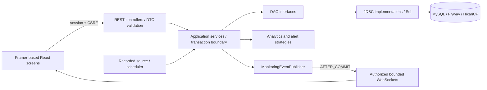

# Architecture and OOP

Controllers bind versioned HTTP contracts. Services enforce biomedical and authorization rules and own transactions. Persistence is behind interfaces. `Sql` acquires transaction-aware JDBC `Connection` instances through `DataSourceUtils`, closes statements/results with try-with-resources, and returns connections to Hikari. It does not use JdbcTemplate, JPA, Hibernate or an ORM. User values are always prepared-statement parameters; SQL structure is explicit. MySQL generated columns enforce one active admission per bed/patient, one current assignment per device and one active alert per rule.

Immutable Java records encapsulate patient identity, admission associations, provenance and typed status; waveform samples are defensively copied. `MeasurementCode` owns canonical-unit and waveform capabilities. Validation stays in ingestion services so callers cannot turn a failed quality observation into a zero value. Constructors inject dependencies; services do not construct repositories or locate beans.

`MonitoringDevice` is a small abstract capability base. ECG, oximetry, respiratory, NIBP and temperature adapters reuse only its real shared behavior. `DeviceAdapterFactory` selects a `DeviceAdapter` polymorphically; a composite-capability adapter supports multiplex monitors. A hardware transport is not simulated by these capability declarations.

`SignalAnalyzer`, `AnalysisModel`, `AlertRule`, `AlertEvaluator`, `ReportGenerator`, `MeasurementSource`, `DatasetImporter` and `MonitoringEventPublisher` are strategy or boundary interfaces. `PersistentThresholdEvaluator` composes a `ThresholdRule`; it does not inherit a contrived clinical model. `BaselineAnomalyModel` and `CsvReportGenerator` are replaceable implementations. `JsonDatasetImporter` parses explicit canonical observation batches; the internal ingestion endpoint already accepts the same JSON representation with Bean Validation. No importer guesses units or unavailable channels.

Services publish domain transport envelopes through the publisher interface. A Spring application-event implementation dispatches to an after-commit listener, so subscribers see committed state. The socket handler checks admission scope on handshake and each event, checks the underlying HTTP session on events/heartbeats, and bounds transport buffers. It supplies ephemeral notifications, not a durable event log. REST is the authoritative resynchronization path.

Ingestion serializes writers per admission with `SELECT ... FOR UPDATE`; alert evaluation also locks the rule. Batched prepared inserts are atomic with audit and alert creation. Source/event identities are unique per scalar or waveform stream. Batch generated keys provide stable persisted IDs in responses. Alert workflow updates use an optimistic version check. Simulation row locks serialize cursor advancement and lifecycle writes across scheduler and HTTP requests.

Clinical context, analytics snapshot and user domain types exist independently from optional scoring. The schema has storage for clinical context/snapshots; current analytics is computed on demand, and no NEWS2 score is exposed. Reports persist their generated content to prevent later observations from changing an exported snapshot.

The frontend ports the newer Framer visual contract, rather than the older Sleek baseline: near-black surfaces, Inter typography, square cards, thin boundaries and a fixed four-item navigation. Shared Panel, State, Status, Range, Chart and Pager components maintain presentation consistency. It uses native semantic controls, accessible chart tables, missing values, quality/source metadata, true server authentication, role-aware writes and explicit error/retry states. Browser preferences are local; patient data and credentials are not persisted in localStorage.

This is a single-node academic service. Session storage and Spring events are in-process. Horizontal deployment would require shared sessions and a distributed event bus. Clinical alert routing, a durable outbox, certified hardware adapters, regulatory validation and production identity provisioning are separate deployment concerns, not claimed deliverables.
